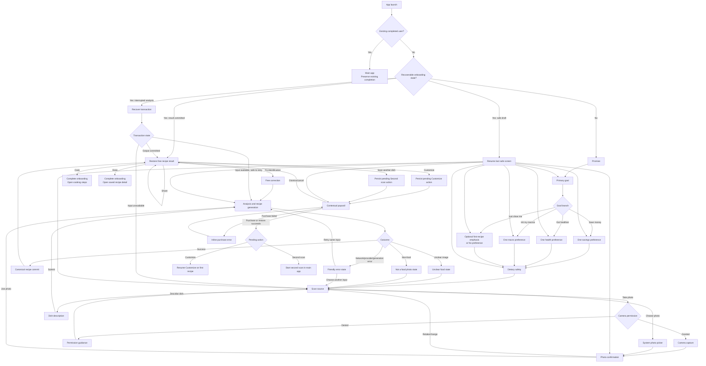

# 1. Executive Summary

> **Document:** Okyo Onboarding Conversion Master Specification
>
> **Status:** Implementation-ready product and engineering specification
>
> **Prepared:** September 3, 2026
>
> **Scope:** First launch through first real recipe, optional premium conversion, and durable handoff into the existing app
> **Source of truth:** This document supersedes earlier onboarding-stage proposals where they conflict with the decisions below. It does not authorize Stage 2 work.

## 1.1 Goal

Okyo should get a new user from first launch to one trustworthy, useful recipe generated from their own dish with the least possible friction. The conversion strategy is simple:

1. Explain the product promise in one screen.
2. Collect only the minimum context that materially improves the first recipe.
3. Let the user complete one real scan for free.
4. Show the complete, usable recipe before asking for payment.
5. Present the paywall only when the user asks for a premium action: customizing that recipe or starting a second scan.
6. Preserve the first recipe and the exact intended action across dismissal, purchase, app backgrounding, process death, and relaunch.

The implementation should reuse the strongest parts of the dormant V4 onboarding architecture—real first-scan generation, canonical recipe commit, resumable premium actions, and privacy-safe analytics—while retaining the current V3 visual system that is already approved for Okyo.

## 1.2 Intended customer experience

A first-time user should feel that Okyo is showing them what it can do, not interviewing them. The target experience is:

- cute, clear, and food-first;
- fast enough to reach the camera within roughly one minute for a decisive user;
- personalized enough to improve the first result;
- honest about AI uncertainty, nutrition, cost, and food safety;
- complete even if the user never pays;
- easy to resume after any interruption.

## 1.3 Canonical funnel

The canonical release path is:

**Promise → Goal → One branch preference → Dietary safety → Scan source → Photo confirmation → Analysis → Free recipe result → Optional premium intent → Contextual paywall → Resume intended action**

There must be one state machine and one behavioral route for debug and release builds. Development tools may simulate responses or entitlement state, but they must not skip, reorder, or complete onboarding through a different route.

## 1.4 Primary implementation recommendation

Use the existing V4 state, persistence, scan transaction, canonical recipe bridge, and pending-premium-action concepts as the behavioral foundation. Re-skin and simplify that flow using the approved V3 components, spacing, illustrations, colors, and motion language. Do not activate the existing V4 UI unchanged: its product architecture is useful, but its visual treatment is not the approved direction.

The highest-priority engineering gap is onboarding completion. The dormant V4 flow persists its draft and first-scan work, but it does not currently perform a complete, durable handoff into the main app. That lifecycle must be implemented and tested before the V4 foundation can become the release path.

## 1.5 Success definition

The implementation is ready to launch when all of the following are true:

- a fresh install can reach a real scan without encountering a paywall;
- the first successful scan produces and canonically saves one complete recipe;
- an unclear or non-food image never becomes a fabricated recipe;
- the first recipe remains usable without purchase;
- factual corrections are not paywalled;
- Customize and second-scan attempts can open a contextual paywall without losing state;
- dismissing the paywall returns to the exact same recipe and scroll/action context;
- a successful purchase resumes the exact action that opened the paywall;
- relaunch during capture, analysis, result, paywall, or purchase recovery returns to a safe deterministic state;
- existing completed users bypass onboarding;
- debug and release builds traverse the same route graph;
- analytics can measure each meaningful step without sending names, descriptions, images, dietary selections, ingredients, or model payloads.

## 1.6 North-star and guardrail metrics

The primary activation metric is **first recipe viewed**, defined as a real generated recipe committed to canonical storage and rendered successfully to the user. Supporting conversion metrics are:

- onboarding start-to-scan-entry rate;
- scan-entry-to-photo-confirm rate;
- analysis success rate;
- time to first recipe;
- first-recipe save rate;
- first-recipe cook-start rate;
- premium-action intent rate;
- contextual paywall conversion rate;
- onboarding completion and next-session return rate.

Guardrails are:

- permission denial and abandonment rates;
- unclear/non-food false-certainty rate from reviewed samples;
- generation retry rate;
- recipe correction rate;
- paywall dismissal-to-app-retention rate;
- accessibility failures;
- crash-free onboarding sessions;
- duplicate recipe creation or duplicate free-scan consumption.

# 2. Product Decisions and Decision Log

## 2.1 Decision status definitions

- **Approved:** May be implemented as written without another product decision.
- **Approved direction:** The outcome is approved, but one implementation detail still needs validation.
- **Needs final confirmation:** Engineering may prepare interfaces and tests, but must not permanently encode the unresolved policy.
- **Deferred:** Intentionally excluded from this onboarding release.
- **Rejected:** Must not appear in the target experience.

## 2.2 Decision log

| ID | Decision | Status | Implementation consequence |
|---|---|---|---|
| D-01 | Every new user receives one real recipe-generation scan before any paywall. | Approved | Remove the pre-scan paywall from the canonical route. Do not substitute mock output for a failed real request. |
| D-02 | The first recipe is complete and useful without payment. | Approved | The user can view the complete recipe, correct factual identification errors, save it, add ingredients to groceries, share it, and begin cooking. |
| D-03 | The first generated recipe must be committed to the existing canonical recipe store before it is presented as durable. | Approved | Reuse the V4 first-scan transaction and canonical bridge. Treat commit failure as a recoverable error, not as success. |
| D-04 | The primary goal choices are Save money, Eat healthier, Hit my macros, and Just show me. | Approved | Add a neutral onboarding intent. Do not coerce Just show me into a canonical goal merely to satisfy an existing type. |
| D-05 | Ask at most one useful preference after the primary goal. | Approved | Replace the existing multi-question and story branches with one compact branch screen per goal. |
| D-06 | The Just show me path remains neutral. | Approved | Its optional preference may influence only the first recipe. If skipped, no canonical primary goal is written. |
| D-07 | Collect dietary allergies, restrictions, and dislikes before the first scan, with a visible skip/None path. | Approved | Reuse the current dietary authority and safety disclaimer; never claim the model guarantees safety. |
| D-08 | Ask for camera permission only after the user taps Take photo. | Approved | The scan-source screen itself must not trigger a system permission dialog. Photo library remains available without requesting broad library access. |
| D-09 | Keep Describe the dish as a secondary scan source. | Approved direction | Retain the real text-analysis route, but visually subordinate it to camera and library until usage and quality are validated. |
| D-10 | Present the paywall only after a user taps Customize or attempts a second scan. | Approved direction; needs final packaging confirmation | Build a trigger-aware paywall and pending-action resume contract. Product must confirm whether both triggers ship simultaneously and which customization actions are premium. |
| D-11 | A factual correction to a wrong dish or materially wrong ingredient is not premium customization. | Approved | Provide a free “Not quite? Fix it” path. Keep creative transformations—such as changing style, goals, or constraints—behind Customize. |
| D-12 | Dismissing the paywall returns to the exact first recipe and preserves the intended action for the current session. | Approved | Paywall is a reversible overlay/state, never a destructive terminal screen. Clear pending action only when the user explicitly abandons it or it completes. |
| D-13 | Purchase or restore resumes the exact action that opened the paywall. | Approved | Persist a typed pending action with recipe ID and safe action parameters before presenting the paywall. |
| D-14 | Completion is a durable transaction, not merely reaching a route enum. | Approved | Write canonical profile/dietary data, confirm recipe durability, write completion, and clear only onboarding-owned draft keys in an ordered, idempotent operation. |
| D-15 | The recommended completion moment is the user's first explicit exit from the free result into the main app or first free cook action. | Needs final confirmation | Keep the result recoverable inside onboarding until that transition. If the process dies first, restore the result. Product should confirm this exact milestone before release. |
| D-16 | After completion, the default destination is the saved first recipe in the existing Recipe Detail experience; Cook goes directly to recipe steps. | Needs final confirmation | Implement destination as a typed handoff so it can be changed without altering the completion transaction. |
| D-17 | Kiko naming and relationship-building move until after the user experiences real value. | Approved direction | Remove fox naming from pre-scan onboarding. Product must choose the post-value trigger; recommended trigger is after first save or first cook completion, never before first recipe. |
| D-18 | Long questionnaires, attribution, household details, barriers, full macro-body setup, notifications, and gamification remain outside first-run onboarding. | Approved / Deferred | Do not collect these during the target flow. Offer them later in context or Settings. |
| D-19 | The existing V3 visual language remains the approved visual foundation. | Approved | Reuse its rounded cards, Manrope typography, Kiko asset registry, warm palette, spacing, and simple motion. Do not ship the dormant V4 visual design unchanged. |
| D-20 | Debug and release use the same state machine and route graph. | Approved | Remove route-changing preview completion and debug bypasses from the canonical controller. Use dependency injection and visible dev controls instead. |
| D-21 | The app must preserve honest AI failure behavior. | Approved | No default pasta, demo meal, or plausible fabricated recipe may appear after a failed real upload or generation. |
| D-22 | Free-scan eligibility must eventually be enforced beyond local AsyncStorage. | Needs final confirmation | Local persistence is acceptable for a gated internal rollout, but public packaging needs an account/device/server policy and abuse tradeoff decision. |
| D-23 | Direct edits to estimated nutrition and cost require explicit uncertainty treatment. | Approved direction | Allow correction or user-entered overrides if implemented, label generated values as estimates, and retain original provenance. Exact editing UI requires technical confirmation. |
| D-24 | Notification permission is not part of onboarding. | Approved | Request later only at a relevant notification feature. |
| D-25 | No account wall is introduced before the first recipe. | Approved | If authentication is later required for cross-device persistence, ask after value and preserve the local recipe through the transition. |

## 2.3 Packaging questions that must be closed before release candidate

Product and engineering must record final answers to these questions in this document or a linked decision record before release candidate sign-off:

1. Do both premium triggers ship: Customize and second scan, or is one staged behind a feature flag?
2. Which edits are factual corrections and therefore free, versus creative customization and therefore premium?
3. Is one free scan enforced per installation, anonymous device identity, account, or server-side household? What happens after reinstall or device change?
4. Does onboarding complete on Done, on first free action, or immediately after the result is safely rendered? This specification recommends explicit exit/free cook.
5. Does normal completion land on Recipe Detail or Home with the recipe highlighted? This specification recommends Recipe Detail.
6. What post-value event introduces Kiko naming: first save, first cook completion, or a later home card?
7. Is Describe the dish shipped in the primary onboarding release or retained behind a rollout flag while quality is measured?

None of these questions blocks building the route contracts, UI states, persistence boundaries, or analytics. They do block final entitlement and lifecycle acceptance tests.

# 3. Current-State Architecture

## 3.1 Runtime entry and onboarding selection

The mobile app currently enters through `apps/mobile/App.tsx`, hydrates persisted state, and delegates root navigation to `apps/mobile/src/navigation/AppNavigator.tsx`. The root navigator uses the existing onboarding completion persistence to decide whether to show onboarding or the main tab experience.

`apps/mobile/src/onboarding-v3/screens/OnboardingV3.tsx` is the active onboarding entry. It contains a V4 assignment gate, but `apps/mobile/src/config/devFlags.ts` currently sets `ONBOARDING_V4_ENABLED` to `false`, so release behavior remains on the V3 route.

The existing completed-user bypass is valuable and must remain: a user with a valid completion marker should not be silently re-enrolled when the new funnel ships. Migration logic must read legacy completion and the new completion schema.

## 3.2 Active V3 route

The current V3 controller and machine live primarily in:

- `apps/mobile/src/onboarding-v3/controller/useOnboardingV3Controller.ts`
- `apps/mobile/src/onboarding-v3/controller/onboardingV3Machine.ts`
- `apps/mobile/src/onboarding-v3/state/onboardingV3Persistence.ts`
- `apps/mobile/src/state/onboardingPersistence.ts`

Its effective route is:

`splash → showcase → nameFox → name → primaryGoal → branchIntro → branch questions/stories → dietaryPreferences → holdReveal → planReady → paywall → postPurchase/input → photoConfirm → analyzing → recipe → cooking/complete`

The primary conversion conflict is structural: the current release paywall appears before the first real scan and result. That asks the user to purchase before they have experienced Okyo's core value. The target specification removes that paywall position.

The active route also includes several pre-value requests that increase time and cognitive load: naming Kiko, collecting a user name, branch introductions, multiple questions, story/interstitial steps, and a plan reveal. These are not inherently bad features; they are placed too early for this funnel.

## 3.3 Dormant V4 route and reusable foundation

The dormant V4 implementation is distributed across:

- `apps/mobile/src/onboarding-v3/screens-v4/OnboardingV4.tsx`
- `apps/mobile/src/onboarding-v3/state/onboardingV4Reducer.ts`
- `apps/mobile/src/onboarding-v3/state/onboardingV4Route.ts`
- `apps/mobile/src/onboarding-v3/state/onboardingV4Draft.ts`
- `apps/mobile/src/onboarding-v3/controller/onboardingV4FirstScan.ts`
- `apps/mobile/src/onboarding-v3/controller/onboardingV4FirstScanTransaction.ts`
- `apps/mobile/src/onboarding-v3/state/onboardingV4ScanPersistence.ts`
- `apps/mobile/src/onboarding-v3/state/onboardingV4PremiumAction.ts`
- `apps/mobile/src/onboarding-v3/state/onboardingV4CanonicalCommit.ts`
- `apps/mobile/src/onboarding-v3/state/onboardingV4CanonicalBridge.ts`
- `apps/mobile/src/onboarding-v3/state/onboardingV4DietarySave.ts`
- `apps/mobile/src/onboarding-v3/screens-v4/FreeRecipeResultScreen.tsx`
- `apps/mobile/src/onboarding-v3/screens-v4/V4PaywallScreen.tsx`
- `apps/mobile/src/onboarding-v3/analytics/onboardingV4Events.ts`

Its current conceptual route is much closer to the desired product:

`splash → promise → primaryGoal → branchQ1 → branchQ2 → optional macroDetails → personalInsight → dietarySafety → plan → scanEntry → photoConfirm → analyzing → recipe → contextual paywall → postPurchase`

The reusable strengths are:

- real image or text input through the current API layer;
- goal and dietary context passed into analysis/generation;
- a persisted in-flight scan transaction;
- ordered analyze, generate, canonical-commit, free-scan-consume, and cleanup steps;
- a complete result before the paywall;
- a pending premium action that can be resumed after purchase;
- live RevenueCat packages rather than invented prices;
- a privacy-aware onboarding event allowlist;
- route-level recovery tests and focused state modules.

## 3.4 Current V4 gaps

The V4 foundation is not release-ready without the following changes:

1. **Completion lifecycle is incomplete.** The route model contains a completion concept, but the audited implementation does not perform the full completion write and root-navigation handoff. Draft comments explicitly leave merge/clear completion lifecycle unfinished.
2. **It still asks too much before scanning.** Two branch questions, macro details, insight, and plan screens should collapse to one branch preference plus dietary safety.
3. **Its visual treatment is not approved.** It must be rendered through V3-aligned components and assets.
4. **Neutral intent is not represented cleanly.** Existing canonical goal types assume one of the three goal branches. Just show me needs a neutral schema rather than a fabricated goal assignment.
5. **Free-scan enforcement is local.** AsyncStorage can be cleared or reset. Public monetization requires a server/account/device policy.
6. **Debug parity is incomplete.** The current project has preview shortcuts and dev bypasses that can jump to Home or mark onboarding complete without traversing the real route.
7. **Result correction needs clearer separation from premium customization.** Wrong identification must be fixable without a paywall.
8. **Result-to-main-app handoff is unspecified.** A stable destination and idempotent completion transaction are required.

## 3.5 Current visual and accessibility observations

The approved V3 system already supplies the correct personality: Manrope typography, warm light surfaces, coral/pink accents, Kiko illustrations, large rounded shapes, friendly plain-language copy, and restrained motion.

Implementation must correct several audited accessibility defects while preserving that look:

- `OnboardingCTA.tsx` uses white text on a light coral button, producing insufficient contrast; use the approved dark ink color on that coral surface or a darker accessible coral.
- progress semantics can announce misleading “Question X of Y” values when story/interstitial screens are counted; the new short funnel should announce actual progress stages.
- looping video/progress assets currently continue playing even when Reduce Motion is enabled; reduced-motion mode must stop or replace loops, not only reduce transition duration.
- some onboarding text disables font scaling; the target flow must support system text scaling within tested layout bounds.

## 3.6 Current scan, dietary, and result behavior

The existing first-scan entry already follows an important permission principle: camera permission is requested after Take photo, and library selection uses the system picker without requesting broad photo-library access. The text description route is also real, persisted, and handled by the same analysis/generation path.

Dietary preferences already have a canonical authority and safe merge behavior. The current safety copy correctly says that Okyo can flag and adapt recipes but that AI and ingredient labels can be wrong. This behavior should be retained.

The dormant free result already contains a full recipe, ingredients, steps, estimated nutrition and cost, and Save, Grocery, Share, Cook, and Customize affordances. The target changes the entitlement contract: Cook remains free for the first recipe, factual correction remains free, and creative Customize or a second scan may trigger premium.

# 4. Target Canonical User Journey

## 4.1 Journey principles

The target journey follows five rules:

1. **Value before monetization.** No paywall before the first real result.
2. **Every question earns its place.** A response must change generation or result presentation immediately.
3. **Permission follows intent.** System permission prompts occur only after the associated user action.
4. **Errors retain progress.** Retrying never forces the user to repeat completed questions.
5. **Premium is contextual.** The paywall explains the exact action the user just requested and returns them safely if dismissed.

## 4.2 Canonical flow and alternate paths



## 4.3 Happy-path target

The fastest photo-based path contains seven user decisions before result:

1. Continue from the promise.
2. Select a primary goal.
3. Select one preference or skip the neutral preference.
4. Save or skip dietary preferences.
5. Select Take photo.
6. Confirm the captured photo.
7. Wait for analysis and view the first recipe.

There is no name entry, fox naming, branch introduction, plan reveal, attribution question, notification request, or pre-scan paywall.

## 4.4 Recovery behavior

The app must persist a safe checkpoint after each submitted answer and before each external transition. On relaunch:

- completed users go to the main app;
- users with a committed first recipe return to that recipe, even if the completion marker was not yet written;
- users whose analysis succeeded but canonical commit did not finish resume the idempotent commit;
- users with an in-flight request and a durable input retry or recover according to transaction status;
- users whose temporary camera file is gone return to scan source with friendly copy;
- users who were on the paywall return to the recipe, with their pending action retained but without automatically reopening a purchase UI;
- users whose purchase completed externally reconcile entitlement, then resume only after the app can verify the entitlement and the pending action is valid;
- no recovery path creates a second copy of the same recipe or consumes another free scan.

## 4.5 Existing-user behavior

The migration must preserve existing onboarding completion. On first launch after the update:

- if legacy completion is valid, write or infer the new schema version lazily and open the main app;
- do not show the new onboarding to existing completed users merely to collect the new questions;
- if an existing user has a legacy partial onboarding draft, either migrate only fields with exact semantic equivalence or restart the compact funnel at Promise; never guess incompatible route positions;
- never delete saved recipes, grocery items, preferences, subscription state, or unrelated local data during onboarding migration.

# 5. Screen-by-Screen Product Specification

## 5.1 Shared screen shell

All pre-result onboarding screens use one shared shell based on the approved V3 system.

**Required shell elements**

- safe-area-aware vertical layout;
- optional Back button after the Promise screen;
- compact progress indicator for Goal through Dietary only;
- Kiko or food artwork drawn from the approved asset registry;
- one primary action anchored above the safe area;
- scrollable content when text scaling or small screens require it;
- keyboard avoidance on text-entry screens;
- persistent answers restored synchronously before the screen becomes interactive;
- no close button that can strand an incomplete first-time user outside both onboarding and the main app.

**Progress semantics**

- Promise: no progress label.
- Goal: “Step 1 of 3.”
- Branch preference: “Step 2 of 3.”
- Dietary safety: “Step 3 of 3.”
- Scan and result: no questionnaire progress; use task-specific status instead.

Progress must expose correct accessibility values and must not count splash, analysis, errors, paywall, or interstitial states as questions.

## 5.2 App launch and existing-user gate

**Purpose:** Hydrate durable data and select the correct root without flashing the wrong experience.

**Visible copy:** None. Show the existing branded splash/loading treatment only as long as hydration requires.

**Logic:**

1. Hydrate canonical store, legacy completion, new onboarding draft, scan transaction, first-recipe reference, subscription entitlement, and pending premium action.
2. If legacy or new completion is valid, open the main app.
3. Else, if a committed onboarding recipe exists, restore the Free Recipe Result.
4. Else, calculate the latest safe pre-result route from the persisted draft.
5. Never choose a route from an untrusted persisted route string alone; derive it from validated data and transaction state.

**Loading state:** Static Kiko/brand art and activity indicator. Do not loop an autoplay video when Reduce Motion is enabled.

**Error state:** If noncritical draft data is corrupt, quarantine/clear onboarding-owned draft keys and start at Promise. If canonical store hydration fails, show a recoverable app-level error rather than allowing generation that cannot be saved.

**Analytics:** None until a real screen is rendered. Do not emit duplicate `onboarding_started` events during hydration retries.

## 5.3 Promise

**Purpose:** Explain the outcome before asking anything.

**Eyebrow:** `MEET OKYO`

**Headline:** `Turn a food photo into a recipe you can actually make.`

**Supporting copy:** `Snap a restaurant dish, choose one from your photos, or describe it. Okyo will build an inspired-by recipe with estimated cost and nutrition.`

**Trust line:** `Your first recipe is free. No card required.`

**Primary CTA:** `Make my first recipe`

**Secondary action:** None.

**Artwork:** One approved Kiko illustration paired with recognizable food imagery. It must reinforce scanning and cooking, not money or subscription.

**Behavior:** Primary CTA advances to Goal and writes the onboarding version/start timestamp. Relaunch after this action returns to Goal.

**Analytics:**

- `onboarding_started` once per onboarding attempt/version;
- `promise_viewed` once per screen impression ID;
- `onboarding_screen_viewed` with `screen_id: promise` if the generic screen event is retained.

**Accessibility:** Headline receives initial focus after navigation settles. Artwork is decorative unless it conveys unique information.

## 5.4 Primary goal

**Purpose:** Select the single dimension that should shape the first recipe and result emphasis.

**Headline:** `What should your first recipe help with?`

**Supporting copy:** `Pick one for now. You can change it anytime.`

**Options:**

- `Save money` — `See how homemade compares.`
- `Eat healthier` — `Get a more balanced inspired-by recipe.`
- `Hit my macros` — `Put protein and calories up front.`
- `Just show me` — `Keep the first recipe neutral.`

**Selection behavior:** Tapping an option selects it but does not auto-advance. This prevents accidental branch changes and supports assistive technology. The CTA enables after selection.

**Primary CTA:** `Continue`

**Back behavior:** Returns to Promise without clearing the selected value.

**Data contract:**

```ts
type OnboardingIntent =
  | 'save_money'
  | 'eat_healthier'
  | 'hit_macros'
  | 'neutral';
```

`neutral` is onboarding-specific. It must not be converted to a canonical `PrimaryGoal` unless the user later chooses one explicitly.

**Analytics:** `goal_selected` on Continue with only the enum value; never send nearby free text.

## 5.5 Save money preference

**Entry condition:** `intent === 'save_money'`.

**Headline:** `What matters most for this copycat?`

**Options:**

- `Lower cost` — emphasize substitutions and total estimated savings.
- `Same taste` — favor flavor fidelity within reasonable ingredient availability.
- `Fast and easy` — favor common ingredients and shorter active time.

**Primary CTA:** `Continue`

**Downstream effect:** Populate a typed first-recipe preference used in the generation prompt and result ordering. It does not silently change dietary restrictions or permanent account preferences.

**Analytics:** `branch_preference_selected` with `branch: save_money` and the enum selection.

## 5.6 Eat healthier preference

**Entry condition:** `intent === 'eat_healthier'`.

**Headline:** `What would feel healthier to you?`

**Options:**

- `More protein`
- `Fewer calories`
- `More plants`
- `Better portions`

**Supporting copy:** `These are estimates and suggestions—not medical advice.`

**Primary CTA:** `Continue`

**Downstream effect:** Adjust generation emphasis and result section order without making disease, treatment, or guaranteed-health claims.

**Analytics:** `branch_preference_selected` with `branch: eat_healthier` and the enum selection.

## 5.7 Hit my macros preference

**Entry condition:** `intent === 'hit_macros'`.

**Headline:** `Which number should lead?`

**Options:**

- `Protein`
- `Calories`
- `Balanced macros`
- `Just show the numbers`

**Supporting copy:** `Okyo estimates nutrition from the photo and generated recipe. Check labels and portions for accuracy.`

**Primary CTA:** `Continue`

**Downstream effect:** Reorder nutrition presentation and guide recipe generation. Do not ask for body weight, height, age, sex, goals, or daily targets during onboarding.

**Analytics:** `branch_preference_selected` with `branch: hit_macros` and the enum selection.

## 5.8 Just show me preference

**Entry condition:** `intent === 'neutral'`.

**Headline:** `Anything to emphasize?`

**Supporting copy:** `Optional—Okyo can keep it simple.`

**Options:**

- `Keep it simple`
- `Lower the cost`
- `Make it more balanced`
- `Show the macros`

**Secondary action:** `No preference yet`

**Primary CTA:** `Continue` after an option is selected.

**Behavior:** `No preference yet` advances immediately with `firstRecipeEmphasis: null`. Selecting an emphasis affects only the first recipe and does not create a permanent goal. If implementation research shows this screen does not improve result quality, it may be skipped for neutral users without changing the rest of the route.

**Analytics:** `branch_preference_selected` with `branch: neutral` and either an enum selection or `selection: none`. Do not infer a canonical goal from this event.

## 5.9 Dietary safety

**Purpose:** Let the user provide constraints that can prevent an obviously unsuitable first recipe while explaining the limitations of AI.

**Headline:** `Anything Okyo should avoid?`

**Supporting copy:** `Choose allergies, eating preferences, or ingredients you dislike.`

**Groups:**

- Allergies
- Eating preferences/restrictions
- Ingredients I dislike

Use the current canonical dietary option IDs and grouping. Do not create a second list with divergent values.

**None behavior:** A visible `Nothing to add` control clears selections only after confirmation if the user already selected items. It is mutually exclusive with all dietary values.

**Safety copy:** `Okyo can flag and adapt recipes, but AI and ingredient labels can be wrong. Always verify ingredients for serious allergies.`

**Primary CTA:** `Save and scan`

**Secondary action:** `Skip for now`

**Behavior:**

- Save writes through the existing dietary preference authority using a merge that does not overwrite unrelated avoidance/settings fields.
- Skip stores a completed-step marker but does not write an invented None preference to the canonical profile.
- Back retains unsaved selections in the onboarding draft.

**Analytics:**

- `dietary_selected` with aggregate counts by group only, never option values;
- `dietary_skipped` with no dietary payload.

**Accessibility:** Each chip/row announces label, selected state, and group. The disclaimer is readable text, not embedded in an image.

## 5.10 Scan source

**Purpose:** Move immediately into the core value action.

**Headline:** `Show Okyo the dish`

**Supporting copy:** `A clear photo with the whole dish works best.`

**Primary action:** `Take photo`

**Secondary actions:**

- `Choose from photos`
- `Describe the dish`

Describe the dish is visually tertiary but remains fully accessible.

**Privacy note:** `Your photo is used to identify the dish and build your recipe. Okyo does not keep the food image unless you save the recipe or explicitly choose to keep it.`

**Take photo behavior:**

1. Emit scan-source selection.
2. Check current camera permission.
3. If undetermined, emit permission prompt event and request permission.
4. If granted, open the camera.
5. If denied, show inline guidance and keep the other sources available.
6. If blocked by system settings, offer `Open Settings` plus `Choose from photos`.

**Choose from photos behavior:** Open the system picker. Do not request broad photo-library permission when the platform picker does not require it. Cancellation returns to this screen without an error toast.

**Describe behavior:** Open the description screen. Do not imply a photo was scanned in analytics or result copy.

**Analytics:** `scan_source_selected` with `source: camera | library | description`; permission events are separate.

## 5.11 Camera permission guidance

**Headline:** `Camera access is off`

**Body when request can be retried:** `Allow camera access to snap your dish, or choose a photo instead.`

**Body when settings are required:** `Turn on Camera for Okyo in Settings, or choose a photo instead.`

**Actions:**

- `Try camera again` or `Open Settings`, depending on OS status;
- `Choose from photos`;
- `Describe the dish`.

**Prohibited behavior:** No repeated automatic prompt loop, no guilt language, and no dead end.

**Analytics:** `permission_prompted` immediately before the OS request and `permission_result` after resolution with `permission: camera` and `result: granted | denied | blocked`.

## 5.12 Dish description

**Purpose:** Provide a real alternative when a photo is unavailable or inaccessible.

**Headline:** `Describe the dish`

**Prompt:** `What is it, and what stood out?`

**Placeholder:** `Example: spicy crispy chicken over rice with cucumber and a creamy orange sauce`

**Helper:** `Include the restaurant or menu name if you know it. Don’t include personal information.`

**Primary CTA:** `Build my recipe`

**Validation:** Trim input; require a meaningful minimum such as 8 non-whitespace characters; cap length using the API's validated maximum; reject whitespace-only input locally. Do not log or send the description to analytics.

**Back behavior:** Returns to Scan Source with draft text preserved locally in the onboarding draft until onboarding completes or the user replaces it.

**Failure behavior:** Retain the text and allow retry/edit.

## 5.13 Photo confirmation

**Purpose:** Let the user verify the exact image before uploading.

**Headline:** `Use this photo?`

**Helper:** `Make sure the whole dish is visible and well lit.`

**Primary CTA:** `Use this photo`

**Secondary actions:**

- `Retake` for camera source;
- `Choose another` for library source.

**Behavior:**

- Show the local image with correct aspect handling and no distortion.
- Persist only a safe local reference needed for recovery; do not copy or retain more versions than necessary.
- Do not begin network upload until `Use this photo` is tapped.
- On confirmation, create an idempotency key and persist the in-flight transaction before starting analysis.

**Analytics:** `photo_confirmed` with source and non-sensitive image metadata only if needed for quality operations, such as coarse orientation. Do not include URI, filename, EXIF, location, hash, base64, or pixels.

## 5.14 Analysis and recipe generation

**Purpose:** Set expectations while the real provider work completes.

**Headline rotation:**

- `Looking at the dish…`
- `Building your inspired-by recipe…`
- `Estimating ingredients, cost, and nutrition…`

**Persistent trust copy:** `Okyo makes an estimate from what it can see. You can fix anything it gets wrong.`

**Behavior:**

1. Validate the persisted transaction and input.
2. Start or reconcile analysis idempotently.
3. Classify food/unclear/non-food separately from provider failure.
4. Generate an inspired-by recipe only for a sufficiently confident food result or an adequate text description.
5. Validate the response schema.
6. Commit the recipe to canonical storage.
7. Mark the free first-scan transaction consumed only after canonical commit succeeds.
8. Store the canonical recipe ID in the onboarding draft.
9. Clear the in-flight payload and navigate to the result.

**Timing:** If processing is unusually long, replace novelty copy with a clear status such as `Still working—this can take a moment.` Never show a fake percentage unless it is tied to real stages.

**Cancellation/backgrounding:** Do not offer destructive cancellation after the request is submitted. Background safely. On foreground, reconcile the existing transaction rather than issuing a duplicate request.

**Analytics:** `analysis_started`; then exactly one terminal event per attempt: `analysis_succeeded`, `analysis_failed`, or `analysis_unclear`.

## 5.15 Unclear food image

**Entry condition:** The model cannot identify the image confidently, but it might contain food.

**Headline:** `Kiko needs a clearer look`

**Body:** `Try a brighter photo that shows the whole dish, or describe what you ordered.`

**Actions:**

- `Try another photo`
- `Describe the dish`
- `Retry this photo` only when the prior failure was technical rather than visual uncertainty.

**Behavior:** Do not consume the free scan. Preserve goal and dietary answers. Do not name a guessed dish.

## 5.16 Non-food image

**Entry condition:** The service has sufficient confidence that the input is not a food dish.

**Headline:** `That doesn’t look like a dish`

**Body:** `Try a photo with the food centered, or describe the dish instead.`

**Actions:** `Choose another photo`, `Take a photo`, and `Describe the dish`.

**Behavior:** Do not consume the free scan. Never convert an unclear result into non-food merely to simplify routing.

## 5.17 Technical analysis or generation error

**Headline:** `We couldn’t build the recipe yet`

**Body:** `Your choices are saved. Try again, or use a different photo.`

**Primary CTA:** `Try again`

**Secondary action:** `Choose another input`

**Behavior:**

- retain the recoverable input and all onboarding answers;
- retry with the same transaction/idempotency identity when safe;
- create a new attempt only after the user changes input;
- never show provider names, status codes, raw model messages, or stack traces;
- never substitute a mock/default recipe in a real session;
- dev-only diagnostics may expose redacted failure class and correlation ID behind an explicit developer panel.

## 5.18 Free recipe result

**Purpose:** Deliver the promised value completely before monetization.

**Top identification block:**

- eyebrow: `YOUR FIRST OKYO RECIPE`;
- title: generated dish title;
- badge: `Inspired-by recipe`;
- confidence line when useful: `Looks like {dish}.`;
- correction action: `Not quite? Fix it`.

Do not describe the recipe as official, exact, authentic, or from the restaurant unless independently verified. “Inspired-by” or “copycat-style” is required.

**Required content:**

- short result summary;
- servings and estimated total time;
- estimated homemade cost and savings when available;
- estimated calories, protein, carbohydrates, and fat when available;
- complete ingredient list with quantities;
- complete ordered cooking steps;
- dietary/allergen caution and any detected conflicts;
- an explicit estimates disclaimer.

**Goal-sensitive ordering:**

- Save money: savings/cost → substitutions → recipe details → nutrition.
- Eat healthier: balanced changes → nutrition → recipe details → cost.
- Hit my macros: macro summary → portions/substitutions → recipe details → cost.
- Neutral: overview → ingredients/steps → nutrition → cost.

Ordering changes emphasis only. It must not hide the complete content from any user.

**Primary action:** `Cook this recipe` — free for the first recipe.

**Free secondary actions:**

- `Save`
- `Add to groceries`
- `Share`
- `Fix it` for factual corrections
- `Done`

**Premium-intent actions:**

- `Customize`
- `Scan another dish`

**Factual correction contract:**

- A user may correct dish identification, obvious ingredient mistakes, serving assumptions, and estimate inputs without being shown the premium paywall.
- A correction is tied to the same first-recipe entitlement and recipe lineage; it must not consume a second scan.
- Creative requests such as “make it keto,” “double the protein,” “make it cheaper,” or “turn it vegan” are Customize and may be premium.
- If a manual edit to nutrition or cost is supported, store it as a user override and label it accordingly; do not overwrite model provenance invisibly.

**Save behavior:** The recipe may already be committed for durability. The Save control should reflect that truth: use `Saved` if onboarding recipes are automatically saved, or use a reversible library visibility flag if product wants an explicit save gesture. Do not create a duplicate recipe on tap.

**Groceries behavior:** Add normalized ingredient items through the existing grocery-list action. Show success and offer `View groceries`. Duplicate handling must follow the current grocery-list behavior.

**Share behavior:** Use the existing native share flow and inspired-by language. Do not include the original private image unless the user explicitly selects a share format containing it.

**Cook behavior:** Complete onboarding transactionally and open the existing cooking/recipe-steps experience for this exact recipe.

**Done behavior:** Complete onboarding transactionally and open this exact recipe in Recipe Detail inside the main app.

**Scroll restoration:** Persist enough UI state to restore the same recipe and a coarse section anchor after a paywall dismissal. Exact pixel offset is optional; returning to the same action section is required.

**Analytics:** `first_recipe_viewed` after the canonical recipe renders; `first_recipe_edited`, `first_recipe_saved`, and `first_recipe_cooked` on successful outcomes, not taps that fail.

## 5.19 Free factual correction

**Headline:** `What should Kiko fix?`

**Preset choices:**

- `Wrong dish`
- `Missing or wrong ingredient`
- `Serving size`
- `Cost or nutrition estimate`

**Optional input label:** `Tell Okyo what you know`

**Primary CTA:** `Update recipe`

**Secondary action:** `Cancel`

**Behavior:**

- preserve the current canonical recipe until the corrected version validates and commits;
- send correction context through the existing real API layer;
- update the same recipe or create a version linked to the same canonical recipe according to existing store constraints;
- return to the result with a brief `Updated` confirmation;
- on failure, keep the prior recipe intact and retain correction input;
- never open the paywall for these factual correction categories.

## 5.20 Premium trigger: Customize

**Trigger:** The user taps `Customize` or selects a clearly generative transformation.

**Before navigation:** Persist:

```ts
type PendingPremiumAction = {
  kind: 'customize_first_recipe';
  recipeId: string;
  source: 'onboarding_first_result';
  requestedAt: string;
  actionVersion: 1;
  payload?: {
    presetId?: string;
  };
};
```

Do not persist arbitrary free text in analytics. If free text is needed to resume a customization, store it only in protected local app state with the shortest practical retention and never include it in telemetry.

**Paywall headline:** `Make this recipe fit you`

**Body:** `Unlock custom versions, more dish scans, and your full Okyo cooking toolkit.`

## 5.21 Premium trigger: second scan

**Trigger:** A user without entitlement taps `Scan another dish` from the first result or starts a new scan after the free scan has been consumed.

**Before navigation:** Persist:

```ts
type PendingPremiumAction = {
  kind: 'start_second_scan';
  source: 'onboarding_first_result' | 'home_scan';
  requestedAt: string;
  actionVersion: 1;
};
```

**Paywall headline:** `Keep turning dishes into recipes`

**Body:** `Unlock more scans, recipe customization, and the rest of Okyo.`

If product chooses not to ship this trigger initially, the route and analytics should remain feature-flagged through one central entitlement policy, not scattered button conditionals.

## 5.22 Contextual paywall

**Purpose:** Explain premium at the moment of demonstrated intent, without taking away the free recipe.

**Required content:**

- trigger-specific headline and body;
- concise benefit list grounded in shipped features;
- package options populated from live RevenueCat offerings;
- purchase CTA populated from the selected package/trial configuration;
- Restore Purchases;
- Terms and Privacy links;
- clear dismiss control;
- statement that the first recipe remains available.

**Dismiss label:** `Keep using my first recipe`

**Dynamic purchase CTA:**

- If the selected package includes a verified trial: `Start {verified trial duration} free trial`.
- Otherwise: `Continue with {package display name}` or the live localized price/period label.

Never hardcode a trial, discount, price, renewal term, or cancellation promise that is not present in the verified store package data.

**Loading state:** Skeleton or spinner for packages with the paywall content stable. Disable purchase until a valid package is selected.

**Offering error:** `Plans aren’t available right now. Your first recipe is still saved.` Actions: `Try again`, `Restore purchases`, `Back to recipe`.

**Purchase in progress:** Lock duplicate purchase taps, keep the system purchase sheet authoritative, and persist the pending action.

**Purchase cancelled:** Treat as a normal return to paywall/result, not an error alert.

**Purchase failed:** Show friendly inline copy and allow retry or return to recipe. Log only normalized failure category.

**Restore:** Reconcile entitlement; if entitled, resume the pending action. If no entitlement is found, show a nontechnical message and remain on paywall.

**Dismiss behavior:** Return to the same recipe and section. Do not mark the free recipe unavailable and do not clear it.

**Analytics:** `premium_action_tapped`, `paywall_viewed`, `purchase_started`, then `purchase_completed` or `purchase_cancelled`; normalized failures may use `purchase_failed` as a guarded operational event.

## 5.23 Post-purchase resume

**Customize:** Verify entitlement, verify the referenced recipe still exists, clear any stale duplicate navigation, open Customize for that recipe, and clear the pending action only after the destination acknowledges it.

**Second scan:** Verify entitlement, complete onboarding if still incomplete, open the main app scan entry, and clear the pending action only after scan entry is ready.

**Invalid/stale action:** Open the first recipe and show `You’re all set—choose what you’d like to do next.` Never crash or silently consume the action.

**Relaunch after external purchase:** Reconcile entitlement during hydration. Do not automatically open a purchase sheet. Resume the valid pending action once, protected by an action-consumed marker.

## 5.24 Completion and main-app handoff

**Recommended completion triggers:**

- `Done` from the first recipe;
- successful transition into Cook;
- successful transition into a post-purchase premium action;
- an explicit main-app destination chosen from the result.

Merely opening the paywall is not completion. Dismissing it leaves the user on the result.

**Completion transaction order:**

1. Verify canonical recipe ID exists.
2. Flush validated goal/intent and dietary changes through their authorities.
3. Persist a versioned completion record with recipe ID and timestamp.
4. Persist a typed handoff destination.
5. Clear only onboarding-owned draft and transient input keys.
6. Switch the root navigator.
7. Consume the handoff exactly once and open Recipe Detail, Cook, Customize, or Scan as appropriate.

Every step must be idempotent. If the app stops after step 3, relaunch must recognize completion and still recover the handoff or default to the saved recipe.

**Default destination:** The first recipe in the existing Recipe Detail screen. Home may show it as the most recent recipe afterward.

## 5.25 Post-value Kiko introduction

Kiko naming is intentionally absent from the first-run funnel. The recommended later prompt is a dismissible celebratory card after the first recipe is saved or the first cook is completed:

- headline: `You and Kiko made your first recipe.`
- optional action: `Give Kiko a nickname`;
- secondary: `Maybe later`.

This is not part of the implementation scope of this onboarding release. The target flow must not depend on a fox name being present.

# 6. What Changes, What Moves Later, and What Stays

## 6.1 Changes now

| Area | Current behavior | Target behavior |
|---|---|---|
| Paywall position | Before the first scan in active V3 | Only after first result and an explicit premium action |
| First value | Delayed by naming, branch stories, plan, and paywall | One real recipe after three compact preference stages |
| Goal choices | Three canonical goals | Three goals plus neutral Just show me |
| Goal branch | Multiple questions/interstitials | One actionable preference |
| First scan | After purchase/bypass in active route | Free, real, and required for activation |
| First recipe | Entangled with onboarding completion | Canonically committed, fully usable, and recoverable |
| Cook | May be treated as premium in dormant result | Free for the first recipe |
| Correction | Not prominent enough and can resemble Customize | Clear free factual-correction path |
| Premium resume | Present in dormant V4 concept | Typed, persisted, trigger-specific, and idempotent |
| Completion | Incomplete in dormant V4 | Explicit transaction and main-app handoff |
| Debug behavior | Preview routes can skip/complete | Same route graph with injected fixtures/entitlement |
| Accessibility | Known contrast, motion, scaling gaps | Corrected while retaining V3 look |

## 6.2 Moves later

The following may still be valuable, but must occur after the first real recipe or in Settings:

- user name;
- Kiko naming;
- additional goal questions;
- personal insight and plan-reveal storytelling;
- restaurant frequency and spending questions;
- household size beyond a recipe serving edit;
- cooking barriers and skill-level questionnaires;
- detailed macro target setup;
- height, weight, age, body composition, or daily calorie targets;
- attribution/source question;
- notification permission;
- account creation for sync;
- referral, streak, badge, XP, challenge, or ranking prompts;
- restaurant packs and premium education not tied to the requested action.

These items should be triggered by context. For example, macro targets belong when the user opens macro settings; notifications belong when the user enables a meal reminder; household size belongs when adjusting servings.

## 6.3 Stays

Retain and reuse:

- V3 visual foundation and approved Kiko artwork;
- Manrope typography and current theme tokens where accessible;
- existing camera and system photo picker integrations;
- the real description-based analysis route;
- canonical dietary preference authority;
- existing AI provider abstraction and API client;
- V4 first-scan persistence and transaction concepts;
- V4 canonical recipe conversion/commit concepts;
- RevenueCat package loading, purchase, and restore integrations;
- canonical saved recipe, grocery list, native sharing, and cooking flows;
- privacy allowlisting and sanitized analytics transport;
- legacy completion checks for existing users.

## 6.4 Explicit removals from the canonical path

Remove these from routing, not necessarily from the repository in the first patch:

- showcase carousel before promise;
- Name Fox;
- user name entry;
- branch intro screens;
- multi-question branch sequences;
- story testimonials and progress interstitials;
- Hold to Reveal;
- Plan Ready;
- pre-scan paywall;
- post-purchase-only scan entry;
- debug preview completion that writes onboarding complete and jumps to Home.

Code deletion should occur only after the new funnel is stable and analytics confirm no rollback dependency. Until then, isolate legacy screens behind a single retired route version rather than leaving mixed navigation conditions.

# 7. Visual and Brand Requirements

## 7.1 Approved direction

The target is an evolution of the current V3 visual language, not a new design system. It should feel recognizably Okyo: cute, clean, simple, friendly, modern, and food-focused. It should not look like a corporate survey, clinical nutrition tool, or generic subscription template.

## 7.2 Typography

- Continue using Manrope through the existing font loading and theme system.
- Use the existing display/title/body hierarchy where it passes text scaling tests.
- Headline copy should fit in two to three lines at default scale and remain readable at 200% scale via wrapping/scrolling.
- Do not set `allowFontScaling={false}` on instructional, status, option, or CTA text.
- Use at least the platform-recommended effective touch target and readable body size; do not shrink critical disclaimers to fit.

## 7.3 Color and contrast

- Preserve warm light backgrounds, dark ink, and coral/pink accents.
- Change CTA text from white to the approved dark ink when the button uses the current light coral fill, unless design selects a darker fill that independently passes contrast.
- Normal text and meaningful icons must meet WCAG 2.2 AA contrast; large text must meet the applicable large-text threshold.
- Selected states cannot rely on color alone; combine border, fill, icon/check, and accessibility state.
- Error, warning, success, and dietary-conflict states need text labels in addition to color.

## 7.4 Components

Reuse or adapt these component families rather than creating parallel primitives:

- onboarding shell/header/back control;
- V3 choice cards;
- V3 CTA/button family;
- Kiko illustration container;
- progress bar/step indicator;
- existing recipe, nutrition, savings, grocery, and paywall components when they already satisfy the target contract.

Component changes must be token-driven and backward-safe. If a shared CTA contrast correction affects other screens, verify all variants visually.

## 7.5 Imagery and Kiko

- Use only approved local Kiko assets from the repository's asset registry.
- Kiko may guide, reassure, and celebrate, but must not obscure food content or safety copy.
- Do not ask the user to name Kiko before the first recipe.
- Decorative art must not increase screen height enough to push the primary action below the fold on common small devices.
- Original food photos must use secure local references and appropriate cover/contain behavior without revealing EXIF or file paths.

## 7.6 Motion

- Use short, purposeful transitions for selection, route changes, and result reveal.
- Avoid progress theater. Analysis motion may indicate activity but cannot imply a fabricated percentage.
- When Reduce Motion is enabled, stop looping video players and continuous decorative movement; replace with a static frame or icon.
- Do not use haptics as the only confirmation. Respect system settings and avoid repeated haptics during analysis.

## 7.7 Layout and responsive behavior

- Design for small phones first, then large phones and tablets.
- Keep primary actions reachable above the bottom safe area.
- Permit vertical scroll rather than truncating copy, options, prices, or legal links.
- On the result, use progressive disclosure and sticky/nearby actions without hiding ingredients or steps.
- Preserve user position when a sheet/paywall closes.
- Support portrait orientation as the required onboarding layout; if the app permits landscape, it must remain usable rather than visually perfect.

## 7.8 Copy style

- Lead with the outcome.
- Use plain, friendly verbs: Make, Show, Choose, Fix, Cook, Save.
- Prefer one idea per sentence.
- Avoid “AI-powered,” provider names, technical errors, and exaggerated certainty.
- Never call generated nutrition, cost, savings, identification, or servings exact.
- Never call an inspired-by recipe official.
- Do not shame permission denial, dietary choices, skipped questions, or paywall dismissal.

# 8. Technical Architecture Plan

## 8.1 Architecture objective

Build one versioned onboarding domain that composes existing services without duplicating canonical app state. The onboarding domain owns only temporary answers, route derivation, scan transaction metadata, first-recipe handoff, and pending premium intent. Saved recipes, dietary preferences, groceries, subscription entitlement, and completed-user identity remain owned by their current canonical modules.

## 8.2 Recommended module boundaries

The exact filenames may follow repository conventions, but responsibilities must remain separated:

```text
apps/mobile/src/onboarding-v3/
  controller/
    useOnboardingController.ts          # orchestration only
    onboardingFirstScan.ts              # provider/API coordination
    onboardingCompletion.ts             # idempotent completion transaction
    onboardingPremiumResume.ts          # pending-action reconciliation
  state/
    onboardingReducer.ts                # pure state transitions
    onboardingRoute.ts                  # pure route derivation
    onboardingDraft.ts                  # validated versioned persistence
    onboardingScanPersistence.ts        # in-flight scan transaction
    onboardingPremiumAction.ts          # typed pending action
    onboardingCanonicalCommit.ts        # canonical recipe bridge
    onboardingDietarySave.ts            # authority-based merge
    onboardingMigration.ts              # legacy completion/draft migration
  screens/
    ...                                 # V3-styled compact screens
  components/
    ...                                 # reused V3 visual primitives
  analytics/
    onboardingEvents.ts                 # strict event allowlist
```

This can be achieved by renaming/consolidating V4 modules or by promoting them behind stable imports. Avoid maintaining `v3`, `v4`, and a third parallel implementation indefinitely.

## 8.3 State model

Use a discriminated, versioned draft that stores data rather than trusting a persisted screen name:

```ts
type OnboardingDraftV5 = {
  schemaVersion: 5;
  attemptId: string;
  startedAt: string;
  updatedAt: string;
  intent?: 'save_money' | 'eat_healthier' | 'hit_macros' | 'neutral';
  branchPreference?:
    | { branch: 'save_money'; value: 'lower_cost' | 'same_taste' | 'fast_easy' }
    | { branch: 'eat_healthier'; value: 'more_protein' | 'fewer_calories' | 'more_plants' | 'better_portions' }
    | { branch: 'hit_macros'; value: 'protein' | 'calories' | 'balanced' | 'numbers_only' }
    | { branch: 'neutral'; value: 'simple' | 'lower_cost' | 'balanced' | 'show_macros' | 'none' };
  dietaryStep: 'not_started' | 'saved' | 'skipped';
  inputDraft?:
    | { kind: 'photo'; source: 'camera' | 'library'; localRef: string }
    | { kind: 'description'; text: string };
  scanTransactionId?: string;
  firstRecipeId?: string;
  resultViewedAt?: string;
  pendingPremiumActionId?: string;
};
```

The persisted structure must be schema-validated on read. Route derivation uses the presence and validity of required data plus transaction status. A stale `route: 'recipe'` value without a valid recipe ID must never render the result.

## 8.4 Pure route derivation

The route selector should be deterministic and pure. Recommended precedence:

1. valid completion → root main app;
2. valid committed first recipe → free result or stored handoff;
3. valid in-flight transaction → analysis/recovery;
4. confirmed input without transaction → confirmation;
5. dietary completed/skipped → scan source;
6. valid branch preference → dietary;
7. valid goal → goal-specific branch preference;
8. started attempt → goal;
9. otherwise → promise.

Paywall presentation should be derived from an explicit UI state plus a valid pending action, not be allowed to outrank a committed result during cold-start recovery. On relaunch, show the result and let entitlement reconciliation decide whether to offer Resume.

## 8.5 Goal and prompt context

Introduce a first-recipe context separate from the long-term profile:

```ts
type FirstRecipeContext = {
  intent: OnboardingIntent;
  preference: OnboardingBranchPreference | null;
  dietarySnapshotVersion: number;
};
```

Rules:

- For the three canonical goals, write the matching canonical `PrimaryGoal` at completion or through the existing profile authority.
- For neutral, leave canonical primary goal unset. Do not randomly assign or use a hidden preferred transformation.
- Always generate from the latest canonical dietary snapshot after the dietary save/skip action resolves.
- Treat preference as generation guidance, never as a safety constraint.
- Store the context/provenance with the recipe only if the canonical recipe schema already supports it or can be extended compatibly.

## 8.6 First-scan transaction

Retain the existing V4 transaction principle and formalize its states:

```ts
type FirstScanTransactionStatus =
  | 'prepared'
  | 'analyzing'
  | 'analysis_succeeded'
  | 'generating'
  | 'generation_succeeded'
  | 'committing'
  | 'committed'
  | 'unclear'
  | 'non_food'
  | 'recoverable_error';
```

Required fields include transaction ID, attempt ID, input kind, safe local input reference or upload reference, timestamps, retry count, result/recipe identity, and normalized error class. Never persist base64 image data or provider payloads in logging/analytics storage.

**Ordering invariant:**

`persist prepared → analyze → validate → generate → validate → canonical commit → record first recipe ID → consume free allowance → clear transient input`

If free allowance consumption is server-authoritative, reserve eligibility before provider spend but finalize it only after commit. The backend API must support idempotency so a retry returns the same committed outcome.

## 8.7 Canonical recipe commit

The canonical bridge must remain the only conversion point from provider/onboarding output into app recipe models.

Required behavior:

- validate IDs, title, servings, ingredients, steps, estimate structures, and safety fields;
- label recipe source as AI generated/inspired-by;
- retain model confidence/provenance only in supported internal fields;
- generate a stable canonical recipe ID once per transaction;
- upsert idempotently using transaction ID;
- avoid auto-inserting grocery items;
- ensure later Save, Share, Cook, Correct, and Customize use the same recipe ID;
- surface commit failures separately from model-generation success.

## 8.8 Completion record and transaction

Use a versioned record rather than a lone boolean:

```ts
type OnboardingCompletionV2 = {
  schemaVersion: 2;
  onboardingVersion: 'compact-first-value-v1';
  completedAt: string;
  firstRecipeId: string;
  completionTrigger: 'done' | 'cook' | 'premium_action' | 'other_main_app_action';
};
```

For backward compatibility, the root gate must accept the existing legacy completion representation. Migration should add the new record opportunistically without invalidating the old one until at least one stable release has passed.

Completion must be safe to call repeatedly. It must never clear canonical recipe, grocery, dietary, entitlement, or unrelated app data. Draft cleanup should use an explicit key allowlist.

## 8.9 Main-app handoff

Persist a one-time handoff separately from completion:

```ts
type OnboardingHandoff =
  | { kind: 'open_recipe'; recipeId: string }
  | { kind: 'start_cooking'; recipeId: string }
  | { kind: 'customize_recipe'; recipeId: string }
  | { kind: 'start_scan' };
```

The main navigator consumes it only after hydration and route readiness. Mark it consumed atomically or with an idempotent navigation token. If the referenced recipe is missing, fall back to Home with a friendly message and log an operational error.

## 8.10 Premium entitlement policy

Centralize access decisions:

```ts
type PremiumCapability = 'customize_recipe' | 'additional_scan';

type AccessDecision =
  | { allowed: true; reason: 'entitled' | 'first_recipe_free' | 'factual_correction' }
  | { allowed: false; reason: 'premium_required'; trigger: PremiumCapability };
```

Every entry point—onboarding result, Recipe Detail, Home scan button, deep link, and restored pending action—must call the same policy. Do not implement entitlement conditions independently in screens.

## 8.11 Pending premium action

Persist only typed, minimal actions. Required lifecycle:

1. Validate action and referenced entities.
2. Persist action before opening paywall.
3. Present paywall with trigger context.
4. On dismiss, keep the recipe and retain the action only for the current recoverable session; do not nag-reopen it.
5. On verified purchase/restore, claim the action using an execution token.
6. Navigate/execute once.
7. Mark consumed and clear.

Use a TTL for stale pending actions, recommended 24 hours, with product confirmation. After TTL, discard the intent but retain the recipe.

## 8.12 Debug and release parity

Delete or disable behavioral shortcuts that:

- mark onboarding complete from branch preview;
- jump directly to Home;
- bypass the paywall by completing onboarding;
- use different route order in development;
- return mock food output after a real provider failure.

Permitted development tools:

- dependency-injected deterministic analysis/generation fixtures;
- development-only entitlement override;
- development-only purchase outcome simulator;
- a route inspector showing validated state and derived route;
- a reset action scoped only to onboarding-owned keys;
- latency and normalized failure injection.

These tools must drive the same events and reducer used in release. A simulated purchase must resume the same pending action path as a verified real entitlement.

## 8.13 Feature flags and rollout controls

Use a small set of centralized flags:

- `compactFirstValueOnboarding`: selects the full canonical onboarding implementation, not individual screen order fragments;
- `describeDishOnboardingSource`: controls only the secondary source;
- `secondScanPaywall`: controls entitlement packaging for subsequent scans;
- `customizePaywall`: controls entitlement packaging for creative customization;
- `serverFreeScanEnforcement`: selects a validated backend capability, with safe fallback policy defined explicitly.

Avoid flags for individual questionnaire screens once the target flow is accepted. Flag combinations must have tests, and remote values must be cached with safe defaults.

## 8.14 API and backend requirements

The existing API may remain the provider boundary, but public release should support:

- idempotency keys for analyze/generate/commit-facing requests;
- normalized `food`, `unclear`, `non_food`, and technical failure outcomes;
- validated response schemas with version identifiers;
- anonymous installation or account entitlement/quota identity, subject to the final free-scan policy;
- server-side free-scan reservation/finalization if monetization abuse matters;
- no long-term image retention by default;
- deletion of temporary image objects on completion, terminal failure, or short expiry;
- correlation IDs safe for support without exposing prompts or images;
- rate limiting and bounded retry behavior;
- provider timeouts and cancellation/reconciliation semantics.

## 8.15 Image lifecycle

Required lifecycle:

1. User selects/captures a local image.
2. App strips or avoids transmitting unnecessary metadata where supported.
3. App transmits only after confirmation.
4. Temporary provider/backend storage expires or is deleted according to policy.
5. Local transient copies are cleared after canonical commit or input replacement.
6. The image is retained with a saved recipe only if the user explicitly chose a flow whose copy states that retention.

The implementation must reconcile this with current save behavior. Auto-committing a recipe for durability does not automatically grant permission to retain the original image.

## 8.16 Testing architecture

Add tests at four levels:

**Pure unit tests**

- reducer transitions;
- route derivation precedence;
- draft schema parsing/migration;
- access decisions;
- pending-action validation and TTL;
- completion idempotency;
- analytics payload allowlisting;
- goal/preference prompt mapping;
- result section ordering.

**Service/transaction tests**

- provider success to canonical commit ordering;
- unclear/non-food does not generate or consume free scan;
- provider failure does not commit mock output;
- commit retry does not duplicate recipe;
- relaunch at every transaction state;
- temporary image cleanup;
- entitlement reconciliation and pending-action claim.

**Component/integration tests**

- every goal branch and Back behavior;
- skip/None dietary behavior;
- permission granted/denied/blocked;
- picker/camera cancellation;
- description validation;
- error retry retaining state;
- result free actions;
- factual correction bypassing premium;
- contextual paywall dismiss and resume;
- completion handoff.

**Device end-to-end tests**

- clean install happy path for camera, library, and description;
- iOS and Android permission paths;
- background/kill during analysis;
- offline before and during request;
- paywall cancellation, failure, purchase, restore, and external completion;
- large text, screen reader, Reduce Motion, and small-screen layouts;
- upgrade from a build with legacy completion;
- debug fixture path and release sandbox purchase path route parity.

# 9. Analytics and Measurement Specification

## 9.1 Measurement principles

- Emit events only after the corresponding state or outcome is true.
- Use one attempt ID for a logical onboarding attempt and one transaction ID for a logical first scan.
- Prevent duplicate terminal events through persisted event markers or idempotent ingestion keys.
- Never send user-entered names, dish descriptions, correction text, image data/URI, dietary item values, ingredients, recipe instructions, prompts, provider output, or exact health data.
- Prefer enums, booleans, coarse durations, counts, and normalized failure classes.
- Route all events through the existing sanitizer and a dedicated onboarding allowlist.
- Analytics failure must never block onboarding.

## 9.2 Canonical event taxonomy

The following names are the target product taxonomy. Existing V4 names may be aliased during migration, but dashboards must not double-count aliases and canonical events.

| Event | Emission point | Required safe properties |
|---|---|---|
| `onboarding_started` | First durable start after Promise loads | `attempt_id`, `onboarding_version`, `assignment` |
| `promise_viewed` | Promise becomes visible | `attempt_id`, `impression_id` |
| `goal_selected` | Goal Continue succeeds | `attempt_id`, `goal` enum |
| `branch_preference_selected` | Preference submits/skips | `attempt_id`, `branch`, `preference` enum/`none` |
| `dietary_selected` | Dietary save succeeds | `attempt_id`, counts by group, `has_allergy` boolean |
| `dietary_skipped` | Skip succeeds | `attempt_id` |
| `scan_source_selected` | Source action tapped | `attempt_id`, `source` |
| `permission_prompted` | Immediately before OS request | `attempt_id`, `permission: camera` |
| `permission_result` | OS permission resolves | `attempt_id`, `permission`, `result` enum |
| `photo_confirmed` | User submits selected image | `attempt_id`, `transaction_id`, `source` |
| `analysis_started` | Durable transaction starts/reconciles first execution | `attempt_id`, `transaction_id`, `input_kind` |
| `analysis_succeeded` | Valid recipe output is ready for commit | `attempt_id`, `transaction_id`, coarse duration bucket |
| `analysis_failed` | Technical terminal/recoverable error is shown | `attempt_id`, `transaction_id`, normalized stage/class, retry count bucket |
| `analysis_unclear` | Unclear or non-food state is shown | `attempt_id`, `transaction_id`, `outcome: unclear | non_food` |
| `first_recipe_viewed` | Committed recipe successfully renders | `attempt_id`, `transaction_id`, `recipe_id`, `goal`, coarse time-to-value bucket |
| `first_recipe_edited` | Free factual correction commits | `attempt_id`, `recipe_id`, correction category enum |
| `first_recipe_saved` | Save state succeeds | `attempt_id`, `recipe_id` |
| `first_recipe_cooked` | Cooking starts or reaches the agreed milestone | `attempt_id`, `recipe_id`, milestone enum |
| `premium_action_tapped` | Premium-required intent is persisted | `attempt_id`, `recipe_id` when applicable, `action` enum |
| `paywall_viewed` | Contextual paywall is visible with packages or error state | `attempt_id`, `trigger`, `offering_state`, `offering_id` if non-sensitive |
| `purchase_started` | Store purchase begins | `attempt_id`, `trigger`, stable package ID, localized price bucket only if approved |
| `purchase_completed` | Entitlement is verified | `attempt_id`, `trigger`, package ID, `source: purchase | restore` |
| `purchase_cancelled` | Store/user cancellation is normalized | `attempt_id`, `trigger` |
| `onboarding_completed` | Completion record commits | `attempt_id`, `recipe_id`, `completion_trigger`, `onboarding_version` |

If the current analytics contract requires `primary_goal_selected`, `personal_insight_viewed`, `personal_plan_viewed`, `dietary_preferences_saved`, `first_scan_input_selected`, `camera_permission_*`, `first_recipe_revealed`, `meaningful_action_selected`, or `purchase_succeeded`, create a documented compatibility mapping. Do not emit obsolete events for screens that no longer exist.

## 9.3 Optional generic screen event

The existing `onboarding_screen_viewed` event may remain for operational funnels if it is strictly allowlisted. Properties:

- `screen_id` from a fixed enum;
- `attempt_id`;
- `onboarding_version`;
- `impression_id`.

It must not replace the canonical semantic events above, and dashboards must define whether repeated views are session impressions or unique-user steps.

## 9.4 Metric definitions

**Activation rate**

`unique users with first_recipe_viewed / unique users with onboarding_started`

**Scan-start rate**

`unique users with scan_source_selected / unique users with onboarding_started`

**Confirmed-input rate**

For photo sources, `photo_confirmed / scan_source_selected(camera or library)`. Description submissions require an equivalent internal submission signal or analysis_started filtered by input kind.

**Analysis success rate**

`unique successful transactions / unique started transactions`, deduplicated by transaction ID.

**Time to first recipe**

Elapsed time from first `promise_viewed` to first `first_recipe_viewed`, excluding time when the app is backgrounded if reliable lifecycle data is available. Report median, p75, and p90.

**Premium intent rate**

`unique users with premium_action_tapped / unique users with first_recipe_viewed`

**Contextual paywall conversion**

`verified purchase_completed / unique paywall_viewed`, segmented by trigger and package.

**Retention after dismissal**

Users who dismiss/cancel and later save, cook, open the first recipe, or return in the defined window. This ensures the paywall does not destroy free-user value.

## 9.5 Funnel segments

Permitted segments include:

- onboarding version/assignment;
- platform and app version;
- goal enum;
- branch preference enum;
- input source;
- permission result;
- analysis outcome class;
- premium trigger;
- new versus migrated completed user;
- accessibility settings only if collected in an aggregate, privacy-reviewed manner and not used for targeting.

Do not segment by exact dietary selections, dish description, recipe ingredients, photo-derived sensitive attributes, or inferred health conditions.

## 9.6 Experiment guidance

Do not A/B test the ethical baseline of value before paywall against a pre-value paywall in the canonical launch. Appropriate later experiments include:

- Promise headline framing;
- neutral branch preference screen versus direct dietary advance;
- relative prominence of Describe the dish;
- Result CTA hierarchy;
- Customize versus second-scan paywall education;
- post-value Kiko introduction timing.

Every experiment must preserve one free real recipe, honest errors, free factual correction, safety copy, and paywall dismissal access to the first recipe.

# 10. Safety, Trust, Accessibility, and Privacy Requirements

## 10.1 AI honesty

- A failed real request must produce a friendly failure state, never a mock or default recipe.
- An unclear image must produce an unclear state unless the service is sufficiently confident it is non-food.
- A non-food classification must not claim certainty beyond the service result.
- Dish identity should use “Looks like” or equivalent uncertainty-aware language when confidence is limited.
- Generated recipes must be labeled inspired-by or copycat-style, never official.
- The user must have a free factual correction route.
- Development fixture mode must be visibly labeled and impossible to enable in production builds.

## 10.2 Food and allergy safety

- Always display: `Okyo can flag and adapt recipes, but AI and ingredient labels can be wrong. Always verify ingredients for serious allergies.`
- Surface detected dietary conflicts before cooking and near affected ingredients.
- Never claim allergen-free, medically safe, contamination-free, or guaranteed compliance.
- Avoid clinical advice or claims that a recipe treats or prevents a condition.
- Nutrition and macro values must be labeled estimates and tied to serving assumptions.
- Food-safety-critical steps may include standard safe-temperature guidance, but generated guidance must not be presented as a substitute for authoritative food-safety instructions.

## 10.3 Cost and savings honesty

- Label ingredient costs, homemade total, restaurant comparison, and savings as estimates.
- Explain assumptions through a lightweight info affordance when values are shown.
- Do not show savings when the source comparison is missing or invalid.
- Do not manufacture a restaurant price from visual inference alone.
- If a user supplies a price, store it as user-provided provenance.
- Use locale-aware currency formatting.

## 10.4 Accessibility acceptance criteria

- All normal text and actionable controls meet WCAG 2.2 AA contrast.
- Every interactive target meets a minimum 44×44-point effective target on iOS and comparable Android guidance.
- Screen reader order follows visual and task order.
- Options expose role, name, selected state, hint where necessary, and disabled state.
- Progress announces true stage values.
- System text scaling through at least 200% remains operable with no hidden CTA, clipped legal price, or inaccessible option.
- Reduce Motion replaces continuous/looping motion with static content and minimizes transitions.
- Color is never the sole carrier of selection, failure, warning, or success.
- Images have appropriate labels or are explicitly decorative.
- Camera, picker, paywall, and correction sheets return focus to the triggering control or relevant result heading.
- Errors are announced through an accessible live region/focus strategy without repeated interruptions.
- Keyboard and switch-control navigation works for all buttons, choices, fields, and legal links.

## 10.5 Privacy requirements

- Do not request camera access until Take photo.
- Do not request broad photo-library permission when the system picker suffices.
- Do not request notification, contacts, location, microphone, health, or tracking permission in onboarding.
- Do not retain user food images unless the user saves/opts in under clear copy; recipe durability alone does not imply image-retention consent.
- Strip or avoid unnecessary EXIF/location data.
- Never log base64 images, local URIs, signed upload URLs, prompts, provider responses, user description/correction text, or secrets.
- Analytics must not contain dietary selections or dish content.
- Apply retention limits to onboarding drafts, temporary uploads, pending free text, and failure payloads.
- Privacy and Terms links must be accessible from the paywall; relevant photo processing disclosure must be visible before upload.
- Account creation, if introduced later, must not discard the anonymous first recipe.

## 10.6 Subscription trust

- Use live localized store price, billing period, trial, and renewal data.
- Never claim a free trial unless the selected package verifies it.
- Restore Purchases remains visible and functional.
- Dismissal is always available from an onboarding-triggered paywall.
- The first recipe stays available after dismissal, cancellation, purchase failure, or offering load failure.
- Purchase success requires verified entitlement, not only a client callback.
- Do not repeatedly reopen the paywall on relaunch without a new user action.

## 10.7 Security and data integrity

- Keep API keys and provider secrets server-side and out of logs.
- Validate every persisted draft and remote payload.
- Bound input sizes and retries.
- Use idempotency for provider and commit operations where supported.
- Reject unknown pending-action kinds and stale recipe references safely.
- Clear only namespaced onboarding keys; never use broad storage resets.
- Treat analytics and debug metadata as untrusted and non-authoritative.

# 11. Technical Risks and Safe Migration Plan

## 11.1 Risk register

| Risk | Severity | Evidence/current condition | Mitigation | Release gate |
|---|---|---|---|---|
| V4 completion does not durably hand off to the main app | Critical | Completion lifecycle is not implemented end-to-end in audited V4 modules | Build idempotent completion record and one-time handoff first; kill-test every transaction boundary | Required |
| First recipe duplicates after retry/relaunch | Critical | Multi-step analyze/generate/commit can be re-entered | Stable transaction ID, canonical upsert, persisted terminal state, duplicate tests | Required |
| Free scan is bypassed by reinstall/storage clearing | High | Current eligibility is local AsyncStorage | Decide anonymous/account/server policy; add reservation/finalization before public monetization | Required for public paid launch; may be accepted for internal rollout |
| Neutral goal is coerced into a false canonical goal | High | Existing goal types represent only three goals | Add onboarding-neutral type and allow canonical goal to remain unset | Required |
| Paywall dismissal loses result or scroll context | High | Root/route transitions can unmount onboarding state | Persist recipe ID and anchor; treat paywall as reversible; integration test | Required |
| Purchase succeeds but intended action is lost or repeats | High | External store lifecycle crosses app/process boundaries | Typed persisted action, entitlement reconciliation, claim/consume token | Required |
| Debug behavior masks release defects | High | Existing preview/bypass can jump to Home or completion | One reducer/route graph; inject services and entitlements only | Required |
| Provider failure shows fabricated content | Critical | Repository rules explicitly prohibit prior mock fallback behavior | Enforce outcome union and release assertion; test no default recipe path | Required |
| Dietary merge overwrites other preferences | High | Multiple preference stores can diverge | Reuse dietary authority and scoped merge; migration tests | Required |
| Original photo retained without informed choice | High | Recipe auto-commit and image lifecycle can become coupled | Separate recipe persistence from image-retention flag; temporary cleanup | Required |
| CTA contrast and motion fail accessibility | Medium/High | Audited V3 contrast and loop behavior | Dark CTA text/accessibly darker fill; stop loops under Reduce Motion; QA | Required |
| Remote flags create impossible route combinations | Medium | Multiple potential rollout flags | Central flag resolver and combination tests; full-flow flag as primary | Required |
| Description input leaks into analytics/logs | High | Free text crosses API boundary | Redaction/allowlist tests, payload size limits, no text analytics | Required |
| Store offering unavailable blocks free experience | High | Network/store availability is external | Always allow return to first recipe; offering retry isolated | Required |
| Legacy completed users see onboarding again | High | Completion schema changes | Dual-read migration, upgrade test, lazy new-record write | Required |
| Existing dirty/partial drafts map to wrong screen | Medium | Old routes have different semantics | Migrate only exact fields; otherwise restart compact funnel at Promise | Required |

## 11.2 Migration strategy

### Phase A: introduce compatible domain primitives

- Add new validated draft/completion schemas without changing the active route.
- Add neutral intent support where it does not break existing `PrimaryGoal` consumers.
- Add completion and handoff transactions with unit tests.
- Add centralized entitlement decision and pending-action versioning.
- Keep legacy completion readable.

### Phase B: assemble compact route behind one full-flow flag

- Reuse V4 transaction/commit/premium concepts through stable imports.
- Render the compact screens with V3 components and approved assets.
- Remove pre-scan paywall from the flagged route.
- Ensure all source, error, result, and paywall states are reachable through the same reducer.
- Instrument canonical analytics without changing the release default.

### Phase C: internal and sandbox validation

- Run deterministic fixture cases and real provider sandbox cases.
- Validate RevenueCat sandbox purchase, cancel, failure, restore, and relaunch.
- Test migration from legacy complete and representative partial drafts.
- Complete accessibility and image-retention audits.
- Confirm no route-changing debug shortcuts remain.

### Phase D: staged rollout

- Enable the full-flow flag for internal users, then a small production cohort.
- Monitor crash-free sessions, analysis failure, first-recipe activation, duplicate commits, paywall returns, and support reports.
- Roll back by switching the whole route version, not by selectively reintroducing old screens.
- Preserve recipes and completion records across rollback.

### Phase E: retire legacy route

- After a stable observation window and one backward-compatible app release, remove unreachable legacy screens and flags.
- Retain migration readers long enough for users upgrading from older versions.
- Remove obsolete analytics events only after dashboard and ingestion consumers migrate.

## 11.3 Safe rollback

A rollback must never erase a first recipe or completion marker. The route flag may return new incomplete users to the legacy route only if product explicitly accepts the old pre-scan monetization behavior; preferred rollback is to a known stable compact build. Completed compact-flow users always remain completed.

Persisted schema readers should be forward-tolerant: an older build that cannot understand a newer draft should ignore/quarantine that draft, not clear canonical data. New completion records should coexist with the legacy boolean/marker during the rollback window.

## 11.4 Data migration rules

- Legacy completed → completed; no re-onboarding.
- Legacy primary goal → new intent only when values are exactly equivalent.
- Legacy dietary values → read through canonical dietary authority; do not re-import from stale onboarding draft.
- Legacy partial branch answers → do not infer the new single preference unless there is an explicit one-to-one mapping approved and tested.
- Legacy user/fox names → retain in existing profile state but do not surface a naming screen.
- Dormant V4 committed recipe → restore result if canonical recipe ID validates.
- Orphaned transaction without usable input → return to Scan Source and clear only that transaction after recording normalized recovery state.

# 12. Phased Implementation Plan

## 12.1 Phase 0 — Decision closure and baselines

**Objective:** Close the minimum policy questions and capture current behavior before code changes.

**Tasks:**

- Confirm D-10, D-15, D-16, D-17, D-22, and D-23.
- Record current funnel event volumes and baseline crash/error rates.
- Confirm current RevenueCat offering/package behavior in sandbox.
- Confirm image upload and retention behavior across mobile, API, and provider.
- Identify the canonical Recipe Detail and Cook navigation contracts.
- Decide rollout cohort and rollback owner.

**Exit criteria:** Signed decision record, confirmed package policy, and named owners for mobile, API, analytics, design QA, and release.

## 12.2 Phase 1 — Persistence, completion, and entitlement foundation

**Objective:** Make state transitions durable before changing the user-facing funnel.

**Tasks:**

- Implement versioned draft parsing and migration.
- Add neutral onboarding intent without forcing canonical goal.
- Implement pure route derivation.
- Implement idempotent first-recipe completion transaction.
- Implement one-time handoff destination.
- Centralize capability access decisions.
- Version and validate pending premium actions.
- Add unit tests for all boundary and recovery states.

**Exit criteria:** Tests prove no duplicate recipe/completion/action across repeated calls and simulated process death.

## 12.3 Phase 2 — Compact pre-scan experience

**Objective:** Replace pre-value friction using the approved V3 design language.

**Tasks:**

- Build Promise, Goal, four branch preference variants, and Dietary Safety in the shared shell.
- Remove naming, plan, story, and pre-scan paywall routes from the flagged flow.
- Correct CTA contrast, text scaling, progress semantics, and Reduce Motion behavior.
- Persist each submitted answer and restore Back behavior.
- Implement canonical analytics for these screens.

**Exit criteria:** Every goal reaches Scan Source in three preference stages; accessibility checks pass on supported device matrix.

## 12.4 Phase 3 — First scan and recovery

**Objective:** Deliver one reliable real first scan.

**Tasks:**

- Integrate camera, library, and optional description sources.
- Preserve intent-triggered permission handling.
- Formalize scan transaction statuses and idempotency.
- Implement unclear, non-food, and technical error states.
- Confirm provider failure cannot invoke demo/mock results.
- Implement temporary image cleanup and background/relaunch reconciliation.
- Add API support for idempotency and normalized outcomes if missing.

**Exit criteria:** Camera/library/description success and all failure/relaunch cases pass integration and device testing with no duplicate recipe or consumed allowance on failure.

## 12.5 Phase 4 — Complete free result

**Objective:** Make the first recipe genuinely useful without payment.

**Tasks:**

- Render complete recipe data in goal-sensitive order.
- Add inspired-by, estimate, and safety copy.
- Connect Save, Grocery, Share, Cook, and Done to canonical features.
- Implement free factual correction and safe recipe versioning.
- Implement result restoration and section-anchor return.
- Connect completion and main-app handoff.

**Exit criteria:** A non-paying user can view, correct, save, shop, share, and cook the first recipe; completion/relaunch always returns to a valid canonical destination.

## 12.6 Phase 5 — Contextual monetization

**Objective:** Convert demonstrated intent without removing free value.

**Tasks:**

- Add centralized Customize and second-scan access checks.
- Persist trigger-specific pending actions.
- Adapt the existing V4/RevenueCat paywall to V3 styling and trigger-specific copy.
- Populate all commercial terms from live verified packages.
- Implement dismiss, cancellation, failure, purchase, restore, and external purchase reconciliation.
- Resume exact action once after entitlement verification.

**Exit criteria:** All store sandbox cases pass; dismissal always returns to the first recipe; no duplicate purchase calls or action execution.

## 12.7 Phase 6 — Analytics, accessibility, and rollout hardening

**Objective:** Make the funnel measurable, safe, and release-ready.

**Tasks:**

- Complete canonical event migration and dashboard definitions.
- Run automated privacy payload tests.
- Perform VoiceOver/TalkBack, large text, contrast, Reduce Motion, keyboard, and switch-control QA.
- Test upgrades from legacy completion and partial states.
- Validate debug/release route parity.
- Run production-like provider and store latency/failure tests.
- Stage rollout and review guardrails daily during initial exposure.

**Exit criteria:** Launch checklist is signed, no critical/high open defects, and rollback is rehearsed.

# 13. Implementation Backlog

## 13.1 Priority definitions

- **P0:** Required for safe activation; release blocker.
- **P1:** Required for the intended conversion experience; should ship in the first release.
- **P2:** Valuable follow-up that may ship after the funnel is stable.

Effort is expressed as **S** (up to roughly two focused engineering days), **M** (roughly three to five days), or **L** (multi-module or cross-team work requiring decomposition). Estimates are relative, not commitments.

## 13.2 Foundation and state

### ONB-001 — Version the compact onboarding draft

- **Priority/Effort:** P0 / M
- **Owner:** Mobile
- **Dependencies:** None
- **Work:** Define schema, validator, storage key, migration reader, quarantine behavior, and explicit key cleanup list.
- **Acceptance criteria:** Invalid fields cannot select a route; repeated hydration is deterministic; canonical data is never cleared.

### ONB-002 — Add neutral onboarding intent

- **Priority/Effort:** P0 / M
- **Owner:** Mobile + API prompt owner
- **Dependencies:** ONB-001
- **Work:** Separate onboarding intent from canonical primary goal; update prompt/result ordering types and tests.
- **Acceptance criteria:** Just show me can generate a neutral recipe without writing a false permanent goal.

### ONB-003 — Consolidate route derivation

- **Priority/Effort:** P0 / M
- **Owner:** Mobile
- **Dependencies:** ONB-001, ONB-002
- **Work:** Create one pure selector with the precedence in §8.4; remove route decisions scattered across screens.
- **Acceptance criteria:** Table-driven tests cover every data combination and reject impossible routes.

### ONB-004 — Implement idempotent completion transaction

- **Priority/Effort:** P0 / L
- **Owner:** Mobile
- **Dependencies:** ONB-001, canonical recipe store
- **Work:** Versioned completion, ordered writes, cleanup allowlist, retry, legacy dual-read.
- **Acceptance criteria:** Process termination after every write boundary still leads to a valid completed or recoverable state.

### ONB-005 — Implement one-time main-app handoff

- **Priority/Effort:** P0 / M
- **Owner:** Mobile/navigation
- **Dependencies:** ONB-004
- **Work:** Typed destination, hydration-aware consumption, fallback, duplicate-navigation guard.
- **Acceptance criteria:** Done/Cook/Customize/Scan opens the intended destination once across warm and cold launches.

## 13.3 Compact pre-scan UI

### ONB-010 — Build V3-aligned shared onboarding shell

- **Priority/Effort:** P0 / M
- **Owner:** Mobile/design
- **Dependencies:** None
- **Work:** Safe areas, scroll, header/back, step progress, Kiko slot, fixed CTA area, screen reader focus.
- **Acceptance criteria:** Small-screen and 200% text layouts remain usable; progress semantics are accurate.

### ONB-011 — Correct shared CTA contrast and states

- **Priority/Effort:** P0 / S
- **Owner:** Mobile/design
- **Dependencies:** Visual token confirmation
- **Work:** Dark ink on current coral or approved accessible alternative; verify pressed/disabled/loading states.
- **Acceptance criteria:** All variants pass contrast and visual regression checks.

### ONB-012 — Respect Reduce Motion for looping onboarding media

- **Priority/Effort:** P0 / S
- **Owner:** Mobile
- **Dependencies:** Asset inventory
- **Work:** Do not start/loop players under Reduce Motion; provide static frame.
- **Acceptance criteria:** No continuous decorative motion when the setting is enabled.

### ONB-013 — Implement Promise and Goal

- **Priority/Effort:** P0 / M
- **Owner:** Mobile
- **Dependencies:** ONB-002, ONB-010
- **Work:** Exact copy, four intents, persistence, analytics.
- **Acceptance criteria:** Selection is deliberate, recoverable, and produces the correct next branch.

### ONB-014 — Implement one preference per branch

- **Priority/Effort:** P0 / M
- **Owner:** Mobile + API prompt owner
- **Dependencies:** ONB-003, ONB-010
- **Work:** Four variants, exact enums, neutral skip, prompt mapping.
- **Acceptance criteria:** Each answer changes only documented generation/result behavior.

### ONB-015 — Adapt Dietary Safety

- **Priority/Effort:** P0 / M
- **Owner:** Mobile
- **Dependencies:** Dietary authority, ONB-010
- **Work:** Reuse canonical IDs/groups, Save, Skip, Nothing to add, disclaimer, safe merge.
- **Acceptance criteria:** No unrelated preference fields are overwritten; analytics contains counts only.

### ONB-016 — Remove pre-value routes from canonical graph

- **Priority/Effort:** P0 / M
- **Owner:** Mobile
- **Dependencies:** ONB-013–015
- **Work:** Eliminate naming, intro, stories, plan, reveal, and pre-scan paywall from flagged route without deleting rollback code yet.
- **Acceptance criteria:** No route or Back action reaches a removed screen.

## 13.4 Scan and generation

### ONB-020 — Adapt Scan Source

- **Priority/Effort:** P0 / M
- **Owner:** Mobile
- **Dependencies:** ONB-003
- **Work:** Camera, system picker, secondary description, privacy copy, cancellation behavior.
- **Acceptance criteria:** Screen does not request permission on render; every source reaches a valid confirmation/submission state.

### ONB-021 — Harden camera permission flow

- **Priority/Effort:** P0 / S
- **Owner:** Mobile
- **Dependencies:** ONB-020
- **Work:** Undetermined/granted/denied/blocked states, Settings link, analytics ordering.
- **Acceptance criteria:** No prompt loop or dead end on iOS/Android.

### ONB-022 — Formalize first-scan transaction and idempotency

- **Priority/Effort:** P0 / L
- **Owner:** Mobile + API
- **Dependencies:** Existing V4 transaction modules
- **Work:** State enum, request identity, durable checkpoints, recovery, canonical upsert, allowance ordering.
- **Acceptance criteria:** Retrying/relaunch cannot duplicate recipe or charge allowance twice.

### ONB-023 — Normalize AI outcomes

- **Priority/Effort:** P0 / M
- **Owner:** API + Mobile
- **Dependencies:** ONB-022
- **Work:** Typed success/unclear/non-food/technical outcome, user-facing routing, redacted diagnostics.
- **Acceptance criteria:** No error route renders a plausible recipe; unclear is not automatically classified non-food.

### ONB-024 — Implement scan error and retry screens

- **Priority/Effort:** P0 / M
- **Owner:** Mobile
- **Dependencies:** ONB-023
- **Work:** Exact copy/actions for unclear, non-food, and technical failure; state retention.
- **Acceptance criteria:** Failure never repeats onboarding questions or consumes free allowance.

### ONB-025 — Enforce temporary image lifecycle

- **Priority/Effort:** P0 / L
- **Owner:** Mobile + API/security
- **Dependencies:** ONB-022
- **Work:** Metadata handling, temporary upload expiry/deletion, local cleanup, explicit retention flag.
- **Acceptance criteria:** Privacy review confirms no unintended long-term copy remains after commit/failure.

### ONB-026 — Decide and implement public free-scan enforcement

- **Priority/Effort:** P0 / L
- **Owner:** Product + API + Mobile
- **Dependencies:** Final D-22 decision
- **Work:** Identity/quota reservation/finalization, offline/reinstall policy, support tooling.
- **Acceptance criteria:** Policy is consistent across onboarding and all additional-scan entry points.

## 13.5 Result and free value

### ONB-030 — Adapt complete free result to V3 styling

- **Priority/Effort:** P0 / L
- **Owner:** Mobile/design
- **Dependencies:** ONB-022, canonical recipe bridge
- **Work:** Identification, complete recipe, goal-sensitive order, estimates/safety, responsive layout.
- **Acceptance criteria:** All four intents show complete content and approved disclosures.

### ONB-031 — Connect free Save without duplication

- **Priority/Effort:** P0 / S
- **Owner:** Mobile
- **Dependencies:** ONB-030
- **Work:** Align auto-commit versus visible Save semantics; use one recipe ID.
- **Acceptance criteria:** Repeated taps/relaunch produce one recipe and truthful Saved state.

### ONB-032 — Connect free Grocery and Share

- **Priority/Effort:** P1 / M
- **Owner:** Mobile
- **Dependencies:** ONB-030
- **Work:** Existing grocery normalization/dedup; native share with inspired-by language and photo consent.
- **Acceptance criteria:** Success/failure states are visible and private image is never shared implicitly.

### ONB-033 — Connect free Cook and Done handoffs

- **Priority/Effort:** P0 / M
- **Owner:** Mobile/navigation
- **Dependencies:** ONB-004, ONB-005, ONB-030
- **Work:** Transactional completion and exact destination.
- **Acceptance criteria:** User lands on the same recipe; cold launch after transition remains correct.

### ONB-034 — Implement free factual correction

- **Priority/Effort:** P0 / L
- **Owner:** Mobile + API
- **Dependencies:** ONB-030, product packaging confirmation
- **Work:** Categories, optional detail, provider correction, validation, safe version commit, failure rollback.
- **Acceptance criteria:** Wrong dish/ingredient/serving/estimate correction never opens paywall or consumes second scan.

### ONB-035 — Restore result and action-section anchor

- **Priority/Effort:** P0 / M
- **Owner:** Mobile
- **Dependencies:** ONB-030
- **Work:** Recipe ID restoration, coarse anchor persistence, missing-recipe fallback.
- **Acceptance criteria:** Paywall dismiss and relaunch return to the same recipe and relevant section.

## 13.6 Premium conversion

### ONB-040 — Centralize capability access policy

- **Priority/Effort:** P0 / M
- **Owner:** Mobile + product
- **Dependencies:** Packaging decision
- **Work:** Customize, factual correction, first cook, additional scan decisions from one service.
- **Acceptance criteria:** All entry points return the same decision for the same entitlement/context.

### ONB-041 — Version pending premium actions

- **Priority/Effort:** P0 / M
- **Owner:** Mobile
- **Dependencies:** ONB-040
- **Work:** Typed schema, validation, TTL, claim/consume, stale fallback.
- **Acceptance criteria:** Purchase resume executes exactly once and never targets a missing recipe without fallback.

### ONB-042 — Build trigger-aware V3-styled paywall

- **Priority/Effort:** P0 / L
- **Owner:** Mobile/design
- **Dependencies:** RevenueCat, ONB-041
- **Work:** Exact contextual copy, live packages, legal/restore, accessible dismiss, offering error.
- **Acceptance criteria:** No invented commercial terms; free recipe remains accessible in all non-success outcomes.

### ONB-043 — Complete purchase/restore reconciliation

- **Priority/Effort:** P0 / L
- **Owner:** Mobile
- **Dependencies:** ONB-041, ONB-042
- **Work:** Duplicate tap guard, verified entitlement, cancellation/failure mapping, cold-start resume.
- **Acceptance criteria:** Sandbox matrix passes on iOS and Android.

## 13.7 Analytics, QA, and rollout

### ONB-050 — Implement canonical analytics allowlist

- **Priority/Effort:** P0 / M
- **Owner:** Mobile/data
- **Dependencies:** Event schema approval
- **Work:** Event adapters, dedupe, sanitizer tests, obsolete mapping.
- **Acceptance criteria:** Automated payload snapshots contain no prohibited fields.

### ONB-051 — Build funnel dashboard and alerts

- **Priority/Effort:** P1 / M
- **Owner:** Data/product
- **Dependencies:** ONB-050
- **Work:** Metric definitions in §9, version segmentation, failure and duplicate alerts.
- **Acceptance criteria:** Internal runs reconcile event counts by attempt/transaction.

### ONB-052 — Remove route-changing debug shortcuts

- **Priority/Effort:** P0 / M
- **Owner:** Mobile
- **Dependencies:** New route ready
- **Work:** Replace branch preview completion and paywall bypass with injected fixtures/entitlement.
- **Acceptance criteria:** Debug and release produce identical route transitions in snapshot tests.

### ONB-053 — Complete accessibility QA

- **Priority/Effort:** P0 / L
- **Owner:** Mobile/design QA
- **Dependencies:** All UI stories
- **Work:** Contrast, 200% text, VoiceOver/TalkBack, Reduce Motion, focus, targets, errors.
- **Acceptance criteria:** No critical/serious issue remains; results documented per platform.

### ONB-054 — Complete migration and relaunch matrix

- **Priority/Effort:** P0 / L
- **Owner:** Mobile QA
- **Dependencies:** ONB-004, ONB-022, ONB-041
- **Work:** Legacy complete/partial, every new checkpoint, process kill, upgrade/rollback.
- **Acceptance criteria:** Expected route/data outcomes match a signed test matrix.

### ONB-055 — Stage rollout and monitor guardrails

- **Priority/Effort:** P0 / M
- **Owner:** Release/product/data
- **Dependencies:** Launch checklist
- **Work:** Cohorts, stop thresholds, owner rotation, rollback drill, daily review.
- **Acceptance criteria:** Rollout advances only when predefined activation, error, crash, and trust guardrails pass.

## 13.8 Post-launch follow-ups

### ONB-060 — Test neutral branch preference value

- **Priority/Effort:** P2 / M
- **Owner:** Product/data
- **Work:** Compare optional neutral preference against direct-to-dietary, preserving all ethical guardrails.

### ONB-061 — Introduce post-value Kiko naming

- **Priority/Effort:** P2 / M
- **Owner:** Product/design/mobile
- **Work:** Choose contextual trigger and build dismissible prompt independent of onboarding completion.

### ONB-062 — Contextual profile completion

- **Priority/Effort:** P2 / L
- **Owner:** Product/mobile
- **Work:** Ask deferred questions only where they unlock an immediate feature, with separate analytics and skip behavior.

# 14. Final Launch Checklist

## 14.1 Product and copy

- [ ] One real first scan and complete first recipe are confirmed as free.
- [ ] Customize versus factual correction definitions are signed off.
- [ ] Second-scan and Customize premium triggers are confirmed.
- [ ] Completion moment and default destination are confirmed.
- [ ] Just show me remains neutral in profile and prompt behavior.
- [ ] Describe the dish launch status is confirmed.
- [ ] Every screen uses the approved exact copy or a reviewed replacement.
- [ ] No official-recipe, exact-nutrition, exact-cost, guaranteed-safety, or invented-trial claim remains.
- [ ] Deferred questions and Kiko naming do not appear before first value.

## 14.2 Core journey

- [ ] Clean install reaches Scan Source after Promise, Goal, Preference, and Dietary only.
- [ ] No paywall appears before the first real recipe.
- [ ] Camera, library, and enabled description paths work.
- [ ] Camera permission is requested only after Take photo.
- [ ] Permission denial/blocked states preserve alternatives.
- [ ] Picker/camera cancellation returns safely without an error.
- [ ] Photo confirmation precedes upload.
- [ ] Analysis uses real API output in production.
- [ ] Success commits exactly one canonical recipe.
- [ ] Free allowance is consumed only under the approved successful-commit policy.

## 14.3 Failure and recovery

- [ ] Unclear image shows an unclear state without guessing.
- [ ] Non-food image shows a non-food state only at sufficient confidence.
- [ ] Provider/network/schema/commit failures show friendly retry states.
- [ ] No real failure can render mock/default pasta or other fixture content.
- [ ] Goal and dietary answers survive every retry.
- [ ] Relaunch from every persisted checkpoint resolves deterministically.
- [ ] Interrupted transactions do not duplicate provider work, recipes, or allowance consumption.
- [ ] Missing temporary input returns to Scan Source safely.
- [ ] Temporary images are cleared according to policy.

## 14.4 Free result

- [ ] Complete ingredients, steps, servings, time, estimates, and cautions render.
- [ ] Goal-sensitive ordering works for all four intents without hiding content.
- [ ] Inspired-by and estimate labels are visible.
- [ ] Wrong identification and factual errors can be corrected free.
- [ ] Save is truthful and cannot duplicate the recipe.
- [ ] Grocery add uses existing deduplication and shows feedback.
- [ ] Share does not include the original photo without explicit choice.
- [ ] Cook is free for the first recipe and opens the exact recipe.
- [ ] Done opens the exact saved recipe after completion.

## 14.5 Paywall and purchase

- [ ] Only approved premium actions open the paywall.
- [ ] Trigger context is persisted before paywall presentation.
- [ ] Paywall copy matches Customize versus second scan.
- [ ] Packages, price, period, trial, and renewal details come from live verified store data.
- [ ] Restore Purchases, Terms, Privacy, and dismiss are present and accessible.
- [ ] Offering failure returns to the first recipe.
- [ ] Cancellation is non-punitive and returns safely.
- [ ] Purchase failure permits retry and retains the recipe/action.
- [ ] Verified purchase/restore resumes the exact action once.
- [ ] Relaunch does not automatically reopen a purchase sheet.

## 14.6 Completion and migration

- [ ] Completion transaction is idempotent.
- [ ] Completion record includes version and first recipe ID.
- [ ] Onboarding draft cleanup is key-allowlisted.
- [ ] Main-app handoff is consumed once and has a missing-entity fallback.
- [ ] Legacy completed users bypass onboarding.
- [ ] Legacy partial data follows the approved migration table.
- [ ] Upgrade and rollback do not delete recipes, groceries, preferences, or entitlement.
- [ ] No active V4/compact user can become trapped between root navigators.

## 14.7 Analytics and privacy

- [ ] Canonical event names and compatibility aliases are documented.
- [ ] Each event fires at the true outcome, not merely on tap.
- [ ] Attempt, transaction, and impression deduplication works.
- [ ] Payload tests prove no image, URI, description, correction text, dietary value, ingredient, prompt, or provider response is sent.
- [ ] Analytics failure does not block the user.
- [ ] Photo-processing and retention copy matches actual implementation.
- [ ] No unnecessary permission appears in onboarding.
- [ ] Server/client logs are redacted and bounded.

## 14.8 Accessibility and visual QA

- [ ] V3 visual foundation is preserved.
- [ ] CTA text/background contrast passes AA.
- [ ] All meaningful text/icons pass applicable contrast.
- [ ] Touch targets meet platform minimums.
- [ ] 200% text scaling is operable on smallest supported screens.
- [ ] VoiceOver and TalkBack order, labels, states, and focus are correct.
- [ ] Reduce Motion stops loops and continuous decorative animation.
- [ ] Progress announces actual steps.
- [ ] Errors and async completion are announced accessibly.
- [ ] Paywall price/legal content remains visible and navigable at large text.

## 14.9 Engineering and release operations

- [ ] Unit, service, integration, and device test suites pass.
- [ ] Debug and release traverse the same route graph.
- [ ] Production builds cannot enable fixtures or entitlement simulation.
- [ ] Feature-flag combinations have tests and safe cached defaults.
- [ ] Crash and normalized failure monitoring are live.
- [ ] Duplicate recipe/free-scan alerts are live.
- [ ] Rollout cohort, stop thresholds, owners, and rollback steps are documented.
- [ ] Support has user-safe guidance for scan failures, restore, and missing entitlement.
- [ ] No critical or high risk in §11 remains unmitigated.

# 15. Explicit Non-Goals

This specification does not authorize or require:

- implementing Stage 2 or any later roadmap stage;
- rebuilding the entire app navigation or state stack;
- replacing the approved V3 visual system;
- shipping the dormant V4 visual design unchanged;
- adding a social feed, comments, direct messages, followers, or maps;
- adding restaurant discovery or live menu integrations;
- adding official restaurant recipe claims;
- providing medical, dietetic, allergy, or clinical advice;
- guaranteeing ingredient identification, nutrition, cost, savings, or safety;
- adding detailed calorie targets, body measurements, or health-data integrations during onboarding;
- adding notification permission during onboarding;
- adding account creation before the first recipe;
- adding Kiko naming before the first recipe;
- adding referral, XP, badge, leaderboard, challenge, or gamification steps to first-run onboarding;
- adding household, budget, attribution, cooking-skill, or barrier questionnaires before first value;
- redesigning the Home, Saved, Grocery, Savings, or Profile experiences beyond the minimum typed handoff and access-policy integration required here;
- creating a second recipe engine or parallel canonical recipe model;
- hardcoding subscription prices, trials, discounts, or renewal language;
- using local-only free-scan enforcement as an unexamined permanent monetization control;
- retaining user photos by default merely because a generated recipe is saved;
- using production user content in debug fixtures or analytics;
- deleting legacy onboarding code before the new route has passed rollout and rollback requirements;
- changing unrelated source, test, asset, configuration, or package files as part of this documentation task.

The implementation team should treat any work outside these boundaries as a separate product decision and separately scoped change.
